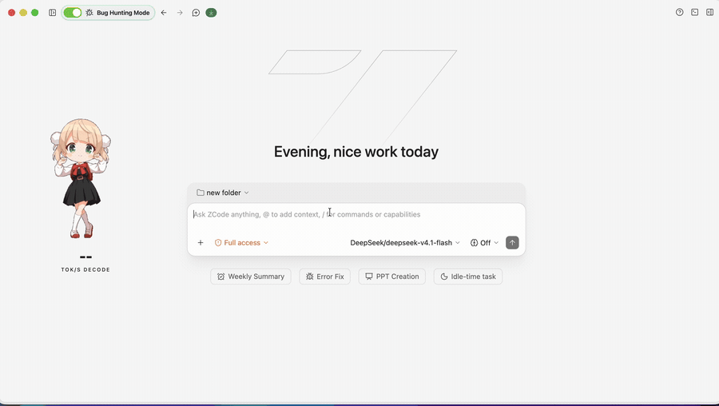

<div align="center">
  

  <h1>ZCode — Patched</h1>

  <p><strong>A fork of <a href="https://github.com/zai-org/ZCode">zai-org/ZCode</a> with a built-in network-traffic monitor and per-reply generation-speed stats.</strong></p>

  <p>
    
    
    
  </p>
</div>

---

## What's different in this fork

This is the upstream ZCode AI coding workspace with two additions, kept as small, self-contained patches on top of the original source:

### 🛰️ Network tab — a Burp-style egress monitor, built in
A live history of **every outbound connection** the harness makes, reachable from the right-hand **"Open tab"** grid (next to Browser) and the `+` menu. It answers a simple question: *where is this thing actually sending my traffic?*

- **Catches everything the app does over the network** — model API calls, `WebFetch`, telemetry, and even `curl`/tools the model spawns in a subprocess. It works at the OS socket level (polling the host process subtree), so it sees traffic that in-process HTTP hooks miss.
- **Resolves hostnames, not just IPs** — shows `api.z.ai`, `google.com`, etc., falling back to the raw IP when there's no name.
- **Classifies each connection** — `external` (public internet, flagged in red), `lan`, `tailscale`, `loopback`, `private` — with an "External only" filter so you can focus on what leaves your machine.
- **Burp-flow-log feel** — sortable table of Time · Protocol · Scope · Host · Port · Process, expandable rows, a live external-connection counter, and a filter box.

> Spec: [`docs/features/network-history-pane.md`](docs/features/network-history-pane.md)

### ⚡ Generation-speed stats
Per-reply decode/prefill throughput and TTFT shown inline in both the desktop conversation and the terminal UI (e.g. `117 tok/s decode · 43,248 tok/s prefill · TTFT 0.5s`).

<div align="center">
  <!-- Demo of the Network tab filtering live egress -->
  
</div>

---

## Quick start (run from source)

**Prerequisites:** Git, **Node.js 24.14.0**, **pnpm 10.33.2**. The versions are pinned in [`mise.toml`](mise.toml) — [mise](https://mise.jdx.dev/) will install them for you. Run everything from the repo root.

```bash
# 1. install deps + build the workspace (first run takes a while)
pnpm bootstrap

# 2. launch the patched desktop app in dev mode
pnpm dev:desktop
```

The Network tab shows up on the right pane the moment the app starts.

---

## Build a packaged app

A helper script builds a signed-for-local-use `ZCode.app` for Apple Silicon:

```bash
./scripts/build-macos-app.sh            # arm64 (default)
./scripts/build-macos-app.sh x64        # Intel
```

Under the hood it runs the documented upstream flow with the one gotcha that bites everyone baked in (`ZCODE_ENV=production`, or you get a separate "ZCode Preview" build with its own data dir):

```bash
pnpm bootstrap
ZCODE_ENV=production pnpm bundle:desktop --skip-build --skip-prepare --os mac --arch arm64
```

The finished app is printed at the end of the run (under `packages/desktop/dist-*/`). For Linux/Windows, swap `--os`/`--arch` in `pnpm bundle:desktop` accordingly.

> See [`README.en.md`](README.en.md) for the full upstream build/dev/packaging documentation (web dev server, CLI distribution, etc.).

---

## Where the patches live

| Area | Files |
| --- | --- |
| Network capture engine (OS-level) | `packages/desktop/src/host/hostNetworkHistory.ts` |
| Shared protocol / schema | `packages/shared/src/network-history.ts`, `channels.ts`, `validation.ts`, `platform.ts` |
| Main ↔ renderer plumbing | `packages/desktop/src/main/desktopHostProcess.ts`, `preload/index.ts`, `renderer/src/desktopPlatform.ts` |
| UI (pane + store + side-pane launcher) | `packages/ui/src/NetworkHistoryPane.tsx`, `store/networkHistoryStore.ts`, `app-shell/*` |
| Generation-speed stats | `packages/shared/src/generationSpeed.ts`, `packages/ui/src/v4/assistantGenerationSpeed.ts`, `apps/zcode-cli/packages/tui/src/generationStatsLine.ts` |

A note on how the capture works and why it's OS-level (model/tool HTTP runs in a `zcode-cli` subprocess, not the host) is in the feature spec linked above.

---

## Credits & license

Forked from **[zai-org/ZCode](https://github.com/zai-org/ZCode)** (v3.14.3). All upstream code and its notices are retained; see [`LICENSE`](LICENSE) (Apache-2.0), [`NOTICE.md`](NOTICE.md), and [`THIRD-PARTY-NOTICES.md`](THIRD-PARTY-NOTICES.md). The patches described above are contributed under the same Apache-2.0 license.

This fork is not affiliated with or endorsed by Z.ai / zai-org.
